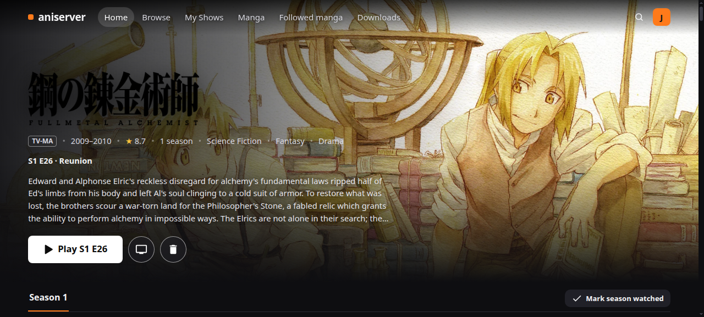
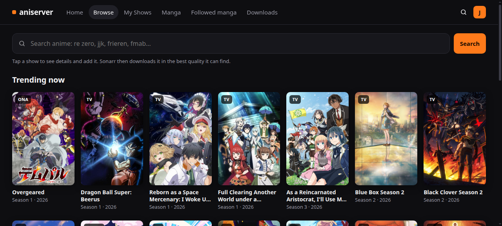
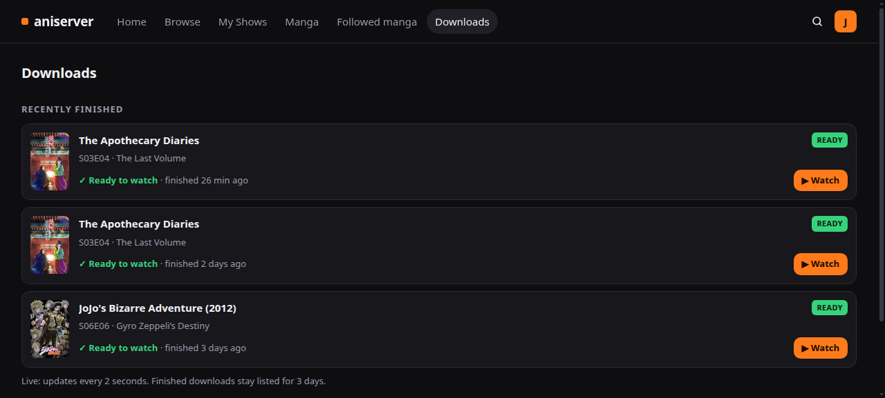

# aniserver

[](LICENSE)  

A home anime server: new episodes download by themselves, play on the living-room TV, and stream anywhere through
**aniserver**, a Netflix-style website with its own adaptive player. Built on Sonarr, Radarr, qBittorrent, Jellyfin
and Kodi, running on one Ubuntu machine.

| Show page | Browse | Downloads |
|---|---|---|
|  |  |  |

## Features

- **Add anime by the name people use** ("jjk", "re zero"). Seasons are matched to TVDB by air date, so split cours,
  continuing seasons and Netflix-first releases get the right episodes.
- **A player that adapts to the connection**: direct play at home, the original repackaged, or a GPU-encoded quality
  ladder away from home, with full-quality anime subtitles (ASS, the release's own fonts) in the browser.
- **Watch on the TV while it downloads**, resume anywhere, skip openings, next episode, Continue on TV.
- **A safety net** that fixes or reports what usually breaks: shows left with nothing to download, stuck or misread
  imports, the TV missing episodes or matching the wrong show, services that stop answering.
- **Anime artwork in Japanese or English** (posters and title logos), set on the Account page.
- **Accounts**: one login per person (password + authenticator code once per browser), each with their own history.
- **Manga**: Nyaa search, downloads and followed series for Komga.

## Getting started

You need a 64-bit Ubuntu/Debian machine with **Python 3.12+**. Kodi for the TV is optional (`sudo apt install kodi mpv`).

```bash
git clone https://github.com/jashuga/aniserver.git ~/aniserver
cd ~/aniserver && ./install.sh
```

`install.sh` downloads whatever is missing of Sonarr, Radarr, Prowlarr, qBittorrent and Jellyfin (into
`~/.local/opt`, as user services, no sudo; ones you already have are used as they are). Then the setup wizard connects
them to each other (media folders in `~/Media`, qBittorrent as the downloader, the Nyaa indexer, Jellyfin's libraries),
asks a few questions, and creates your login (password + authenticator app; the same password signs you into
Jellyfin). The site starts on port 5050. Run `python3 website/app.py setup` again any time to change the answers. Every setting is listed in
`website/config.example.json`; parts you skip (the TV, manga, phone alerts) stay hidden.

To reach it from outside the home, put it behind HTTPS (e.g. Caddy) and set `public_host`.

Tests (no real services needed): `python3 -m unittest discover -s website/tests`

## Layout

| Path | What's there |
|---|---|
| `website/` | The site: `app.py` (entry point and `setup`), `aniserver/` (one module per job), `assets/` (CSS/JS), `tests/` |
| `install.sh` | Installs everything and runs the setup wizard |
| `bin/` | Safety net (`htpc-watchdog`), phone notifications, dynamic DNS, Sonarr/qBittorrent hooks |
| `systemd/user/` | Services and timers |
| `kodi/`, `mpv/`, `recyclarr/` | TV player and quality-profile config |
| `setup/` | `prereqs.sh` (downloads the programs) and optional root setup scripts (examples from this machine) |

Only download what you have the right to.

## License

[MIT](LICENSE). Bundled: [hls.js](https://github.com/video-dev/hls.js) (Apache-2.0) and
[JASSUB](https://github.com/ThaUnknown/jassub) (MIT, includes libass and Liberation Sans, OFL); their license files are
in `website/static/`.
